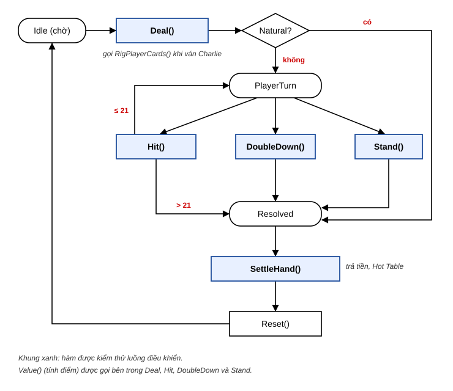
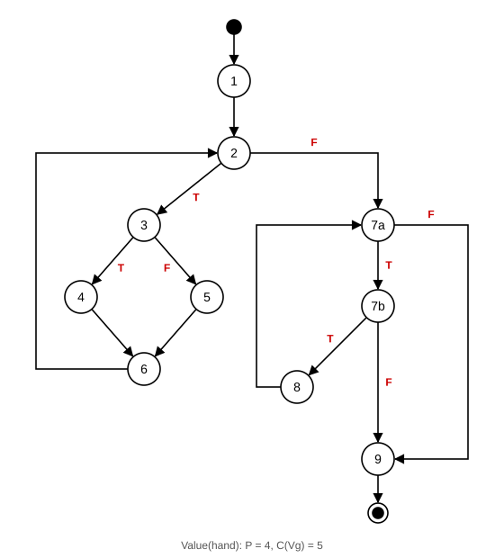
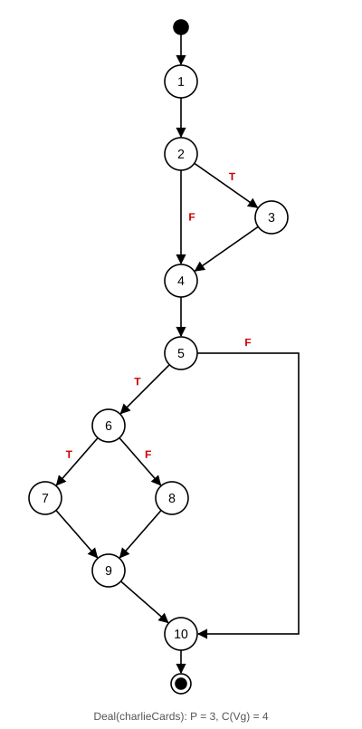
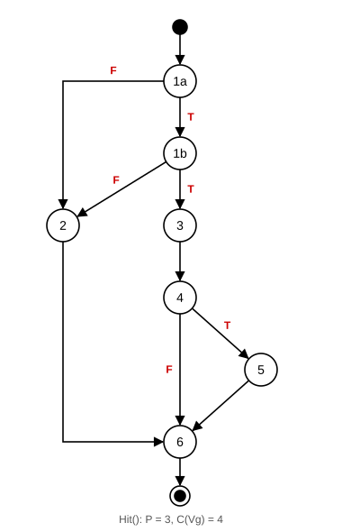
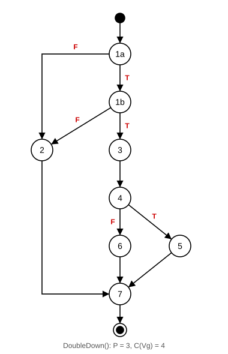
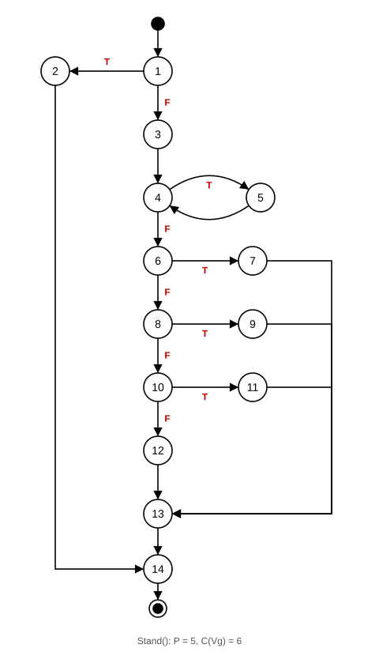
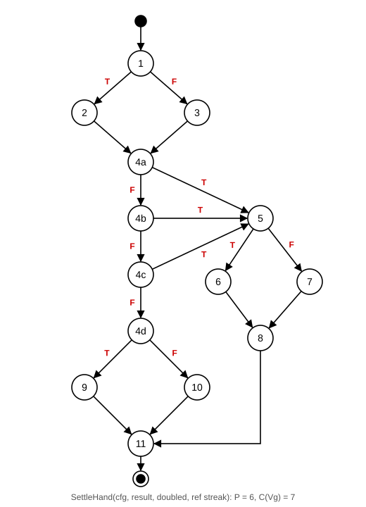
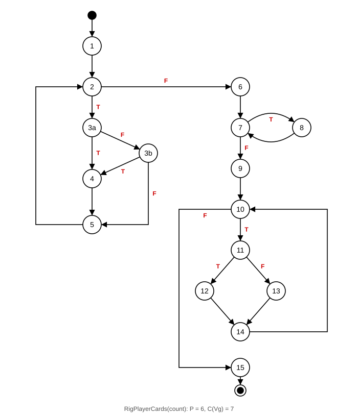

# Kiểm thử luồng điều khiển: chức năng Blackjack

Bài kiểm thử hộp trắng theo luồng điều khiển cho chức năng **Blackjack** của game OverTimer Extended. Phương pháp theo bài giảng "Kiểm thử hộp trắng": đồ thị luồng điều khiển nhị phân, độ phức tạp C(Vg), đường thi hành tuyến tính độc lập, phủ cấp 3, kiểm thử vòng lặp.

| Thành phần | Vị trí |
|---|---|
| Mã nguồn được kiểm thử | `Assets/Scripts/Desk/Laptop/Blackjack/BlackjackGame.cs`, `BlackjackApp.cs` |
| Mã kiểm thử (NUnit, Unity Test Runner, EditMode) | `Assets/Tests/EditMode/BlackjackControlFlowTests.cs` |
| Đồ thị luồng điều khiển | Thư mục này: `CFG_*.svg`, `SoDoTong_VanBlackjack.svg` |
| Nhật ký chạy kiểm thử | Thư mục này: `KetQuaChayKiemThu.txt` |

---

## 0. Chức năng Blackjack và phạm vi kiểm thử

### 0.1 Chức năng
Blackjack là một ứng dụng trên Laptop trong game. Người chơi trả **cược bằng giây đồng hồ** và nhận **thưởng bằng tiền**. Một ván gồm các bước: chia bài, người chơi rút thêm / gấp đôi / dừng, nhà cái chơi, phân thắng thua, trả thưởng.



### 0.2 Kiểm kê mã nguồn của chức năng
Chức năng gồm 5 file, khoảng 45 hàm và thuộc tính:

| File | Vai trò | Hàm chính |
|---|---|---|
| `BlackjackGame.cs` | Luật chơi (C# thuần) | `Value`, `IsSoft`, `IsNatural`, `Deal`, `RigPlayerCards`, `Hit`, `DoubleDown`, `Stand`, `Reset`, `Payout`, `ResultText`, `Draw`, `BuildAndShuffle`… |
| `BlackjackApp.cs` | Nối luật chơi với game: trừ giây, cộng tiền, chuỗi thắng Hot Table, giao diện | `SettleHand`, `StreakBonus`, `OnDeal`, `OnHit`, `OnStand`, `OnDouble`, `Resolve`, `OnAppClosed`, `Refresh`… |
| `CardSlotView.cs`, `CardRowView.cs`, `CardDeckConfig.cs` | Hiển thị lá bài | `ShowCard`, `Render`, `GetSprite`… |

### 0.3 Tiêu chí chọn hàm để kiểm thử luồng điều khiển
1. **C(Vg) ≥ 3.** Hàm có C = 1 chỉ có một đường đi, không cần đồ thị.
2. **Chứa luật chơi hoặc tính tiền**, không phải hiển thị.
3. **Kiểm thử độc lập được.** Các hàm xử lý nút bấm (`OnDeal`, `OnHit`…) cần scene, coroutine và đồng hồ đang chạy, nên được kiểm bằng ca hộp đen ở Play Mode (TC-BJK-7, 8 trong kế hoạch kiểm thử).

Kết quả chọn được **7 hàm**:

| # | Hàm | Bước trong ván | P | C(Vg) | Số ca |
|---|---|---|---|---|---|
| 1 | `BlackjackGame.Value` | Tính điểm (dùng ở mọi bước) | 4 | 5 | 5 + 7 vòng lặp |
| 2 | `BlackjackGame.Deal` | Chia bài | 3 | 4 | 4 |
| 3 | `BlackjackGame.Hit` | Rút thêm | 3 | 4 | 4 |
| 4 | `BlackjackGame.DoubleDown` | Gấp đôi | 3 | 4 | 4 |
| 5 | `BlackjackGame.Stand` | Nhà cái chơi, phân thắng thua | 5 | 6 | 6 |
| 6 | `BlackjackApp.SettleHand` | Trả thưởng, Hot Table | 6 | 7 | 7 |
| 7 | `BlackjackGame.RigPlayerCards` | Xếp bài cho kết thúc "Charlie" | 6 | 7 | 7 + 6 vòng lặp |
| | **Tổng** | | | | **50 ca** |

### 0.4 Quy ước
- **Đánh số:** mỗi câu lệnh hoặc khối lệnh có một số. Một điều kiện ghép (`&&`, `||`) được tách thành các nút a, b (giống `5c1`, `5c2` trong bài giảng), để đồ thị là **nhị phân**.
- **Toán tử `?:` và `switch`** được viết lại thành `if/else` tương đương trước khi đánh số.
- **Trên đồ thị** chỉ ghi số nút và nhãn T/F (đúng/sai) ở nhánh ra của nút quyết định. Điều kiện của từng nút nằm trong bảng đi kèm.
- **Công thức:** C(Vg) = P + 1 (P: số nút quyết định), kiểm tra lại bằng C(Vg) = E − N + 2 (không tính điểm bắt đầu/kết thúc).
- **Đường cơ sở** là đường ngắn nhất khả thi. Sau đó đổi nhánh lần lượt tại từng nút quyết định, giữ nguyên các nút còn lại.
- **Giá trị mong đợi** lấy theo luật Blackjack và `GameConfig`, không chép từ mã.
- **Bộ bài xếp sẵn:** `RiggedRandom` điều khiển thứ tự rút. Thứ tự chia của `Deal`: người chơi (P1), nhà cái (D1), người chơi (P2), nhà cái (D2), rồi các lá rút sau. Ký hiệu lá: A = Át, J/Q/K = 10 điểm.

---

## 1. `Value(hand)`: tính điểm tay bài

### Mã nguồn đánh số
```text
public static int Value(IReadOnlyList<Card> hand)
{
1.    int total = 0;  int aces = 0;  int i = 0;
2.    for (; i < hand.Count; )
      {
3.        if (hand[i].IsAce)
4.            { aces++;  total += 11; }
          else
5.            total += hand[i].BaseValue;
6.        i++;
      }
7.    while ((total > 21) /*7a*/ && (aces > 0) /*7b*/)
8.        { total -= 10;  aces--; }
9.    return total;
}
```

| Nút quyết định | Điều kiện |
|---|---|
| 2 | `i < hand.Count` |
| 3 | `hand[i].IsAce` |
| 7a | `total > 21` |
| 7b | `aces > 0` |

### Đồ thị


### Độ phức tạp
P = 4, nên **C(Vg) = 5**. Kiểm tra: N = 10, E = 13, C = 13 − 10 + 2 = 5.

### Đường thi hành tuyến tính độc lập
1. Start → 1 → 2 → 7a → 9 → End
2. Start → 1 → 2 → 3 → 5 → 6 → 2 → 7a → 9 → End
3. Start → 1 → 2 → 3 → 4 → 6 → 2 → 7a → 9 → End
4. Start → 1 → (2 → 3 → 5 → 6)×3 → 2 → 7a → 7b → 9 → End
5. Start → 1 → (2 → 3 → 4 → 6)×2 → 2 → 7a → 7b → 8 → 7a → 9 → End

### Test case
| ID | Test Path | Inputs (hand) | Expected | RO | Note |
|---|---|---|---|---|---|
| TC-BJK-VAL-1 | 1; 2; 7a; 9 | [ ] | 0 | Pass | Đường cơ sở |
| TC-BJK-VAL-2 | 1; 2; 3; 5; 6; 2; 7a; 9 | [10] | 10 | Pass | Đổi nút 2 |
| TC-BJK-VAL-3 | 1; 2; 3; 4; 6; 2; 7a; 9 | [A] | 11 | Pass | Đổi nút 3 |
| TC-BJK-VAL-4 | 1; (2; 3; 5; 6)×3; 2; 7a; 7b; 9 | [K, Q, 5] | 25 | Pass | Đổi nút 7a; quá 21 không có Át |
| TC-BJK-VAL-5 | 1; (2; 3; 4; 6)×2; 2; 7a; 7b; 8; 7a; 9 | [A, A] | 12 | Pass | Đổi nút 7b; 22 → 12 |

### Bảng phủ cấp 3
| Điều kiện | True | False |
|---|---|---|
| (2) `i < hand.Count` | VAL-2 | VAL-1 |
| (3) `hand[i].IsAce` | VAL-3 | VAL-2 |
| (7a) `total > 21` | VAL-4 | VAL-1 |
| (7b) `aces > 0` | VAL-5 | VAL-4 |

### Kiểm thử vòng lặp
`Value` có hai **lặp đơn liền kề nhau**: vòng `for` (nút 2–6) rồi vòng `while` (nút 7–8). Theo bài giảng, mỗi vòng được kiểm bằng bộ ca của lặp đơn (0, 1, 2, k, n − 1, n, n + 1), vòng còn lại giữ giá trị mặc định.

#### Vòng `for` (số lá trên tay); vòng `while` giữ mặc định: lặp 0 lần (không có Át)
Hàm nhận danh sách lá bất kỳ, không giới hạn số lá, nên **không xác định được n**. Theo chú ý của bài giảng, chỉ cần 4 ca đầu: 0, 1, 2, k.

| ID | Số lần lặp | Inputs | Expected | RO | Note |
|---|---|---|---|---|---|
| TC-BJK-VAL-1 | 0 | [ ] | 0 | Pass | Trùng ca đường 1 |
| TC-BJK-VAL-2 | 1 | [10] | 10 | Pass | Trùng ca đường 2 |
| TC-BJK-VAL-FOR-L2 | 2 | [10, 7] | 17 | Pass | |
| TC-BJK-VAL-FOR-Lk | k = 5 | [2, 3, 4, 5, 6] | 20 | Pass | |

#### Vòng `while` (số lần hạ Át từ 11 xuống 1); vòng `for` chạy theo tay bài của ca
Vòng lặp chạy tối đa bằng số Át trên tay. Một bộ bài có 4 Át nên **n = 4**.

| ID | Số lần lặp | Inputs | Diễn giải | Expected | RO |
|---|---|---|---|---|---|
| TC-BJK-VAL-LP0 | 0 | [A, 6] | 17, không hạ | 17 | Pass |
| TC-BJK-VAL-LP1 | 1 | [A, 6, 9] | 26 → 16 | 16 | Pass |
| TC-BJK-VAL-LP2 | 2 | [A, A, K] | 32 → 22 → 12 | 12 | Pass |
| – | k (2 < k < n − 1) | – | n = 4: không có số nguyên k nào thỏa 2 < k < 3 | – | – |
| TC-BJK-VAL-LP3 | n − 1 = 3 | [A, A, A, K] | 43 → 33 → 23 → 13 | 13 | Pass |
| TC-BJK-VAL-LP4 | n = 4 | [A, A, A, A, K] | 54 → 44 → 34 → 24 → 14 | 14 | Pass |
| – | n + 1 = 5 | – | **Không sinh được**: bộ bài chỉ có 4 Át | – | – |

---

## 2. `Deal(charlieCards)`: chia bài

### Mã nguồn đánh số
```text
public void Deal(int charlieCards = 0)
{
1.   BuildAndShuffle();  _rigged.Clear();
2.   if (charlieCards > 0)
3.       RigPlayerCards(charlieCards);
4.   PlayerHand.Clear();  DealerHand.Clear();  DoubledDown = false;  Result = None;
     PlayerHand.Add(DrawPlayer());  DealerHand.Add(Draw());
     PlayerHand.Add(DrawPlayer());  DealerHand.Add(Draw());
     State = PlayerTurn;
5.   if (IsNatural(PlayerHand))
     {
6.       if (IsNatural(DealerHand))          // Result = IsNatural(DealerHand) ? Push : PlayerNatural
7.           Result = Push;
         else
8.           Result = PlayerNatural;
9.       State = Resolved;
     }
10. }
```

| Nút quyết định | Điều kiện |
|---|---|
| 2 | `charlieCards > 0` (ván được xếp cho kết thúc Charlie) |
| 5 | Người chơi có Natural (2 lá = 21) |
| 6 | Nhà cái cũng có Natural |

### Đồ thị


### Độ phức tạp
P = 3, nên **C(Vg) = 4**. Kiểm tra: N = 10, E = 12, C = 12 − 10 + 2 = 4.

### Test case
| ID | Test Path | Inputs | Expected | RO | Note |
|---|---|---|---|---|---|
| TC-BJK-DEAL-1 | 1; 2; 4; 5; 10 | Deal(0); P: 10, 7; D: 9, 8 | PlayerTurn, Result = None, mỗi bên 2 lá | Pass | Đường cơ sở |
| TC-BJK-DEAL-2 | 1; 2; 3; 4; 5; 10 | Deal(7), seed 7 | Hai lá người chơi đều là 2 hoặc 3; còn 5 lá chờ; PlayerTurn | Pass | Đổi nút 2 |
| TC-BJK-DEAL-3 | 1; 2; 4; 5; 6; 8; 9; 10 | Deal(0); P: A, K; D: 5, 9 | Resolved, PlayerNatural | Pass | Đổi nút 5 |
| TC-BJK-DEAL-4 | 1; 2; 4; 5; 6; 7; 9; 10 | Deal(0); P: A, K; D: A, Q | Resolved, Push | Pass | Đổi nút 6 |

**Đường không khả thi:** 2(T) rồi 5(T). Ván Charlie chỉ chia lá 2 và 3 cho người chơi, nên hai lá đầu tối đa là 6 điểm, không thể là Natural.

---

## 3. `Hit()`: người chơi rút thêm

### Mã nguồn đánh số
```text
public void Hit()
{
1.  if (!( State == PlayerTurn /*1a*/ && PlayerValue < 21 /*1b*/ ))     // if (!CanHit)
2.      return;
3.  PlayerHand.Add(DrawPlayer());
4.  if (PlayerValue > 21)
5.      { Result = PlayerBust;  State = Resolved; }
6. }
```

| Nút quyết định | Điều kiện | T đi tới | F đi tới |
|---|---|---|---|
| 1a | `State == PlayerTurn` | 1b | 2 (không được rút) |
| 1b | `PlayerValue < 21` | 3 | 2 (không được rút) |
| 4 | `PlayerValue > 21` | 5 (thua) | 6 |

### Đồ thị


### Độ phức tạp
P = 3, nên **C(Vg) = 4**. Kiểm tra: N = 7, E = 9, C = 9 − 7 + 2 = 4.

### Test case
| ID | Test Path | Inputs | Expected | RO | Note |
|---|---|---|---|---|---|
| TC-BJK-HIT-1 | 1a; 2; 6 | Chưa chia ván (Idle) | Không rút, tay rỗng, Idle | Pass | Đường cơ sở |
| TC-BJK-HIT-2 | 1a; 1b; 2; 6 | P: 5, 6; Hit được 10 (= 21); Hit lần nữa | Vẫn 3 lá, PlayerTurn | Pass | Đổi nút 1a |
| TC-BJK-HIT-3 | 1a; 1b; 3; 4; 6 | P: 10, 2; Hit được 5 | 17, PlayerTurn, Result = None | Pass | Đổi nút 1b |
| TC-BJK-HIT-4 | 1a; 1b; 3; 4; 5; 6 | P: 10, 2; Hit được 10 | 22, PlayerBust, Resolved | Pass | Đổi nút 4 |

---

## 4. `DoubleDown()`: gấp đôi

### Mã nguồn đánh số
```text
public void DoubleDown()
{
1.  if (!( State == PlayerTurn /*1a*/ && PlayerHand.Count == 2 /*1b*/ ))   // if (!CanDouble)
2.      return;
3.  DoubledDown = true;  _rigged.Clear();  PlayerHand.Add(Draw());
4.  if (PlayerValue > 21)
    {
5.      Result = PlayerBust;  State = Resolved;
        return;
    }
6.  Stand();
7. }
```

| Nút quyết định | Điều kiện | T đi tới | F đi tới |
|---|---|---|---|
| 1a | `State == PlayerTurn` | 1b | 2 |
| 1b | `PlayerHand.Count == 2` | 3 | 2 |
| 4 | `PlayerValue > 21` | 5 (thua ngay) | 6 (tự Stand) |

### Đồ thị


### Độ phức tạp
P = 3, nên **C(Vg) = 4**. Kiểm tra: N = 8, E = 10, C = 10 − 8 + 2 = 4.

### Test case
| ID | Test Path | Inputs | Expected | RO | Note |
|---|---|---|---|---|---|
| TC-BJK-DBL-1 | 1a; 2; 7 | Chưa chia ván | Không gấp đôi, tay rỗng | Pass | Đường cơ sở |
| TC-BJK-DBL-2 | 1a; 1b; 2; 7 | P: 2, 3; Hit được 4 (3 lá) | Từ chối, vẫn 3 lá, PlayerTurn | Pass | Đổi nút 1a |
| TC-BJK-DBL-3 | 1a; 1b; 3; 4; 6; 7 | P: 5, 6; D: 10, 7; Double được 10 | 21, tự Stand, PlayerWin, DoubledDown = true | Pass | Đổi nút 1b |
| TC-BJK-DBL-4 | 1a; 1b; 3; 4; 5; 7 | P: 10, 6; D: 10, 7; Double được 10 | 26, PlayerBust, nhà cái không rút | Pass | Đổi nút 4 |

---

## 5. `Stand()`: nhà cái chơi và phân thắng thua

### Mã nguồn đánh số
```text
public void Stand()
{
1.  if (State != PlayerTurn)
2.      return;
3.  State = DealerTurn;
4.  while (DealerValue < 17)
5.      DealerHand.Add(Draw());
6.  if (DealerValue > 21)
7.      Result = DealerBust;
8.  else if (DealerValue > PlayerValue)
9.      Result = DealerWin;
10. else if (DealerValue < PlayerValue)
11.     Result = PlayerWin;
    else
12.     Result = Push;
13. State = Resolved;
14.}
```

| Nút quyết định | Điều kiện |
|---|---|
| 1 | `State != PlayerTurn` |
| 4 | `DealerValue < 17` (nhà cái phải rút) |
| 6 | `DealerValue > 21` |
| 8 | `DealerValue > PlayerValue` |
| 10 | `DealerValue < PlayerValue` |

### Đồ thị


### Độ phức tạp
P = 5, nên **C(Vg) = 6**. Kiểm tra: N = 14, E = 18, C = 18 − 14 + 2 = 6.

### Test case
| ID | Test Path | Inputs | Expected | RO | Note |
|---|---|---|---|---|---|
| TC-BJK-STD-1 | 1; 3; 4; 6; 8; 9; 13; 14 | P: 10, 7; D: 10, 8 | Nhà cái không rút, DealerWin | Pass | Đường cơ sở |
| TC-BJK-STD-2 | 1; 2; 14 | Chưa chia ván | Không làm gì, Idle, Result = None | Pass | Đổi nút 1 |
| TC-BJK-STD-3 | 1; 3; 4; 5; 4; 6; 8; 9; 13; 14 | P: 10, 7; D: 10, 6; rút 2 | Nhà cái 18 (3 lá), DealerWin | Pass | Đổi nút 4 |
| TC-BJK-STD-4 | 1; 3; 4; 5; 4; 6; 7; 13; 14 | P: 10, 7; D: 10, 6; rút 10 | Nhà cái 26, DealerBust | Pass | Đổi nút 6 |
| TC-BJK-STD-5 | 1; 3; 4; 6; 8; 10; 11; 13; 14 | P: 10, 9; D: 10, 8 | PlayerWin | Pass | Đổi nút 8 |
| TC-BJK-STD-6 | 1; 3; 4; 6; 8; 10; 12; 13; 14 | P: 10, 8; D: 10, 8 | Push | Pass | Đổi nút 10 |

**Đường không khả thi:** đổi riêng nút 6 từ đường cơ sở (4(F) rồi 6(T)). Nếu nhà cái không rút lá nào thì chỉ có 2 lá, và 2 lá không thể vượt 21. Vì vậy TC-BJK-STD-4 phải đổi cả nút 4.

---

## 6. `SettleHand(cfg, result, doubled, ref streak)`: trả thưởng

Hàm này nằm ở `BlackjackApp` và là hàm **tính tiền thật** khi chơi. Hot Table: mỗi ván thắng liên tiếp cộng thêm `blackjackStreakStep` vào thưởng ván thắng kế tiếp, tối đa `blackjackStreakCap`.

### Mã nguồn đánh số
```text
public static int SettleHand(GameConfig cfg, Outcome result, bool doubled, ref int streak)
{
1.  if (doubled)                                   // int mult = doubled ? 2 : 1;
2.      mult = 2;
    else
3.      mult = 1;
4.  switch (result)                                // 4a: == PlayerNatural   4b: == PlayerWin
    {                                              // 4c: == DealerBust      4d: == Push
      case PlayerNatural: case PlayerWin: case DealerBust:
5.      if (result == PlayerNatural)               // baseAmount = ... ? natural : win
6.          baseAmount = cfg.blackjackNaturalPayout;
        else
7.          baseAmount = cfg.blackjackWinPayout;
8.      payout = Round(baseAmount * mult * (1 + StreakBonus(cfg, streak)));
        streak++;  return payout;
      case Push:
9.      return cfg.blackjackPushPayout * mult;
      default:
10.     streak = 0;  return 0;
    }
11.}
```

| Nút quyết định | Điều kiện | T đi tới | F đi tới |
|---|---|---|---|
| 1 | `doubled` | 2 | 3 |
| 4a | `result == PlayerNatural` | 5 | 4b |
| 4b | `result == PlayerWin` | 5 | 4c |
| 4c | `result == DealerBust` | 5 | 4d |
| 4d | `result == Push` | 9 | 10 |
| 5 | `result == PlayerNatural` | 6 | 7 |

### Đồ thị


### Độ phức tạp
P = 6, nên **C(Vg) = 7**. Kiểm tra: N = 14, E = 19, C = 19 − 14 + 2 = 7.

### Test case
Giá trị lấy từ `GameConfig.asset` lúc chạy: thắng \$100, hòa \$25, Natural \$130, bước Hot Table 0,1, trần 0,5.

| ID | Test Path | Inputs (result, doubled, streak) | Expected (tiền, streak sau) | RO | Note |
|---|---|---|---|---|---|
| TC-BJK-SET-1 | 1; 3; 4a; 4b; 5; 7; 8; 11 | PlayerWin, false, 0 | \$100, 1 | Pass | Đường cơ sở |
| TC-BJK-SET-2 | 1; 2; 4a; 4b; 5; 7; 8; 11 | PlayerWin, true, 0 | \$200, 1 | Pass | Đổi nút 1 |
| TC-BJK-SET-3 | 1; 3; 4a; 5; 6; 8; 11 | PlayerNatural, false, 0 | \$130, 1 | Pass | Đổi nút 4a |
| TC-BJK-SET-4 | 1; 3; 4a; 4b; 4c; 5; 7; 8; 11 | DealerBust, false, 2 | \$100 × 1,2 = \$120, 3 | Pass | Đổi nút 4b; có thưởng Hot Table |
| TC-BJK-SET-5 | 1; 3; 4a; 4b; 4c; 4d; 9; 11 | Push, false, 2 | \$25, 2 (giữ nguyên) | Pass | Đổi nút 4c |
| TC-BJK-SET-6 | 1; 3; 4a; 4b; 4c; 4d; 10; 11 | DealerWin, false, 3 | \$0, 0 (mất chuỗi) | Pass | Đổi nút 4d |
| TC-BJK-SET-7 | 1; 2; 4a; 4b; 4c; 4d; 9; 11 | Push, true, 0 | \$50, 0 | Pass | Đường độc lập thứ 7 |

**Đường không khả thi:** 4a(T) rồi 5(F). Nếu kết quả là Natural thì nút 5 luôn đúng. Nhánh 5(F) chỉ đi tới được từ 4b hoặc 4c.

---

## 7. `RigPlayerCards(count)`: xếp bài cho kết thúc "Charlie"

Kết thúc "Charlie": người chơi giữ được 7 lá mà không quá 21. Khi một ván được chọn làm ván Charlie, hàm này lấy các lá 2 và 3 ra khỏi bộ bài, xáo, rồi đưa `count` lá vào hàng đợi để người chơi rút lần lượt. Các lá thấp còn thừa được trả lại bộ bài.

### Mã nguồn đánh số
```text
private void RigPlayerCards(int count)
{
1.  var low = new List<Card>();  int i = _deck.Count - 1;
2.  for (; i >= 0; )
    {
3.      if (_deck[i].Rank == 2 /*3a*/ || _deck[i].Rank == 3 /*3b*/)
4.          { low.Add(_deck[i]);  _deck.RemoveAt(i); }
5.      i--;
    }
6.  i = low.Count - 1;
7.  for (; i > 0; )
8.      { int j = _rng.Next(i + 1);  swap(low[i], low[j]);  i--; }
9.  int take = Math.Min(count, low.Count);  i = 0;
10. for (; i < low.Count; )
    {
11.     if (i < take)
12.         _rigged.Enqueue(low[i]);
        else
13.         _deck.Insert(_rng.Next(_deck.Count + 1), low[i]);
14.     i++;
    }
15.}
```

| Nút quyết định | Điều kiện | T đi tới | F đi tới |
|---|---|---|---|
| 2 | `i >= 0` (còn lá để xét) | 3a | 6 |
| 3a | `_deck[i].Rank == 2` | 4 | 3b |
| 3b | `_deck[i].Rank == 3` | 4 | 5 |
| 7 | `i > 0` (còn lá để xáo) | 8 | 9 |
| 10 | `i < low.Count` | 11 | 15 |
| 11 | `i < take` | 12 (xếp cho người chơi) | 13 (trả lại bộ bài) |

### Đồ thị


### Độ phức tạp
P = 6, nên **C(Vg) = 7**. Kiểm tra: N = 16, E = 21, C = 21 − 16 + 2 = 7.

### Cách dựng dữ liệu kiểm thử
Trong game, hàm này chỉ được `Deal` gọi, ngay sau khi tạo bộ bài đủ 52 lá. Nếu chỉ kiểm qua `Deal` thì bộ bài luôn có đủ 8 lá thấp, và phần lớn các đường thi hành **không thể đi tới**. Vì vậy test gọi thẳng hàm private bằng **reflection** và tự đặt bộ bài (`_deck`) trước mỗi ca. Đây là cách làm hộp xám mà project đã dùng trong `TestHooks`.

### Test case
| ID | Test Path | Inputs (bộ bài, count) | Expected (hàng đợi; bộ bài sau) | RO | Note |
|---|---|---|---|---|---|
| TC-BJK-RIG-1 | 1; 2; 6; 7; 9; 10; 15 | [ ], 1 | rỗng; rỗng | Pass | Đường cơ sở |
| TC-BJK-RIG-2 | 1; 2; 3a; 3b; 5; 2; 6; 7; 9; 10; 15 | [K], 1 | rỗng; [K] | Pass | Đổi nút 2 |
| TC-BJK-RIG-3 | 1; 2; 3a; 4; 5; 2; 6; 7; 9; 10; 11; 12; 14; 10; 15 | [2], 1 | [2]; rỗng | Pass | Đổi nút 3a |
| TC-BJK-RIG-4 | 1; 2; 3a; 3b; 4; 5; 2; 6; 7; 9; 10; 11; 12; 14; 10; 15 | [3], 1 | [3]; rỗng | Pass | Đổi nút 3b |
| TC-BJK-RIG-5 | …; 6; 7; 8; 7; 9; (10; 11; 12; 14)×2; 10; 15 | [2, 3], 2 | {2, 3}; rỗng | Pass | Đổi nút 7 |
| TC-BJK-RIG-6 | …; 9; 10; 11; 13; 14; 10; 15 | [2], 0 | rỗng; [2] | Pass | Đổi nút 11 |
| TC-BJK-RIG-7 | Đường dài: cả 3 vòng lặp chạy nhiều lần, nút 11 đi cả T và F | Bộ 52 lá, 7 | 7 lá 2/3; còn 45 lá, trong đó 1 lá thấp được trả lại | Pass | Giống khi chơi thật |

### Kiểm thử vòng lặp 10 (số lá thấp trong bộ bài)
Vòng lặp 10 chạy đúng bằng số lá 2 và 3 trong bộ bài. Bộ bài thật có 4 lá 2 và 4 lá 3, nên **n = 8**. Mỗi ca dùng bộ bài gồm 1 lá K và L lá thấp, count = 7 như trong game.

| ID | Số lần lặp (L) | Expected (số lá xếp; số lá còn trong bộ bài) | RO |
|---|---|---|---|
| TC-BJK-RIG-LP0 | 0 | 0; 1 | Pass |
| TC-BJK-RIG-LP1 | 1 | 1; 1 | Pass |
| TC-BJK-RIG-LP2 | 2 | 2; 1 | Pass |
| TC-BJK-RIG-LPk | k = 4 (2 < k < n − 1) | 4; 1 | Pass |
| TC-BJK-RIG-LP7 | n − 1 = 7 | 7; 1 | Pass |
| TC-BJK-RIG-LP8 | n = 8 | 7; 2 (lá thứ 8 trả lại bộ bài) | Pass |
| – | n + 1 = 9 | **Không sinh được**: bộ bài chỉ có 8 lá 2 và 3 | – |

---

## 8. Thực hiện kiểm thử và kết quả

### Cách chạy trong Unity
Window → General → Test Runner → tab **EditMode** → chọn `BlackjackControlFlowTests` → **Run Selected**. Mỗi dòng trong các bảng trên là một test có tên trùng mã ca (ví dụ `TC_BJK_STD_4_NhaCaiRutQua21`).

### Kết quả lần chạy ngày 29/10/2026
- **Cách chạy:** chính file test `BlackjackControlFlowTests.cs` được biên dịch với bản build game (`Library/ScriptAssemblies/OverTimer.dll`) và NUnit của Unity, rồi chạy bằng .NET 9 bên ngoài Editor. `GameConfig` được đọc từ `GameConfig.asset`.
- **Kiểm tra bộ chạy:** một kỳ vọng cố ý sai (A + 5 = 17) bị báo lỗi đúng ("Expected: 17 But was: 16"). Như vậy các kết quả Pass là thật, không phải do bỏ qua Assert.
- Nhật ký đầy đủ nằm trong `KetQuaChayKiemThu.txt`.
- **Bổ sung 30/10/2026:** thêm 2 ca vòng `for` của `Value` (FOR-L2, FOR-Lk). Chạy lại 12 ca `Value` theo cùng cách: 12/12 Pass, kiểm tra độ nhạy vẫn báo lỗi đúng. 38 ca của 6 hàm còn lại không đổi mã nên không chạy lại.

| Hàm | Số ca | Pass | Fail |
|---|---|---|---|
| Value | 12 | 12 | 0 |
| Deal | 4 | 4 | 0 |
| Hit | 4 | 4 | 0 |
| DoubleDown | 4 | 4 | 0 |
| Stand | 6 | 6 | 0 |
| SettleHand | 7 | 7 | 0 |
| RigPlayerCards | 13 | 13 | 0 |
| **Tổng** | **50** | **50** | **0** |

### Kết luận và phát hiện
1. **Cả 7 hàm đạt phủ cấp 3 và không phát hiện lỗi.** Mọi điều kiện con đều đã nhận cả giá trị True và False. Phủ cấp 3 bao hàm phủ cấp 2 (mọi nhánh) và cấp 1 (mọi câu lệnh).
2. **Đường không khả thi.** Có 4 chỗ không thể đổi nhánh độc lập: `Deal` 2(T)→5(T), `Stand` 4(F)→6(T), `SettleHand` 4a(T)→5(F), và phần lớn `RigPlayerCards` khi gọi qua `Deal`. Kiểm thử luồng điều khiển phải kết hợp đọc đặc tả, không chỉ đếm đường trên đồ thị.
3. **Hàm `Payout` không được game dùng.** Tiền thưởng thật do `BlackjackApp.SettleHand` tính, có cộng Hot Table. `BlackjackGame.Payout` chỉ được công cụ Editor và các ca TC-BJK-6 cũ gọi. Nên chuyển TC-BJK-6 sang kiểm `SettleHand`, nếu không thì ca đó đang kiểm một hàm không chạy khi chơi.
4. **Ca n + 1 của vòng `while` (`Value`) và vòng chính của `RigPlayerCards` không sinh được.** Vòng `for` của `Value` không xác định được n nên chỉ cần 4 ca 0, 1, 2, k. `Value` vì chỉ có 4 Át, `RigPlayerCards` vì chỉ có 8 lá 2 và 3. Đây đúng là trường hợp "chú ý" trong bài giảng.
